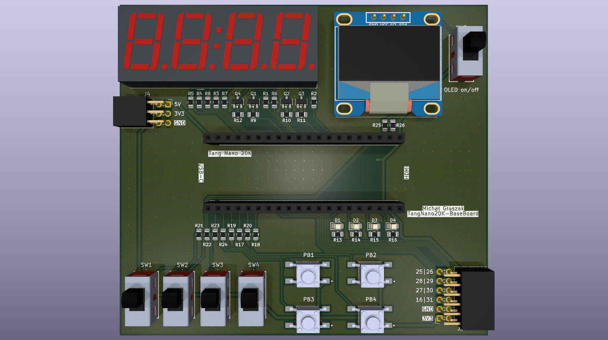
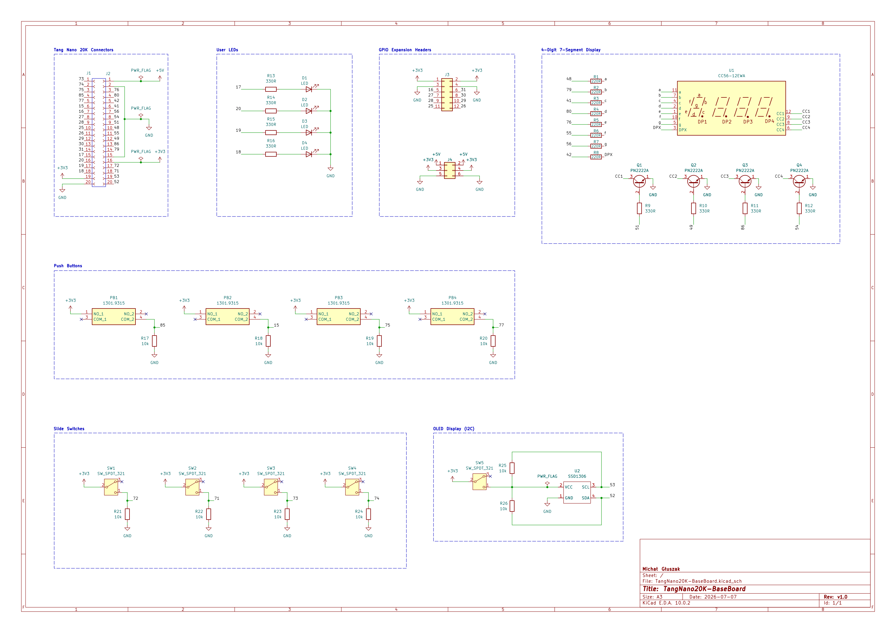
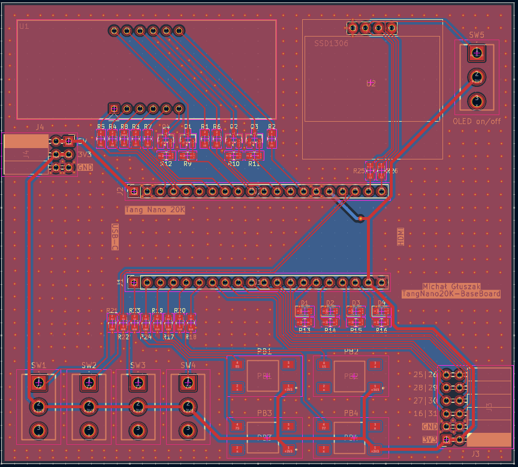
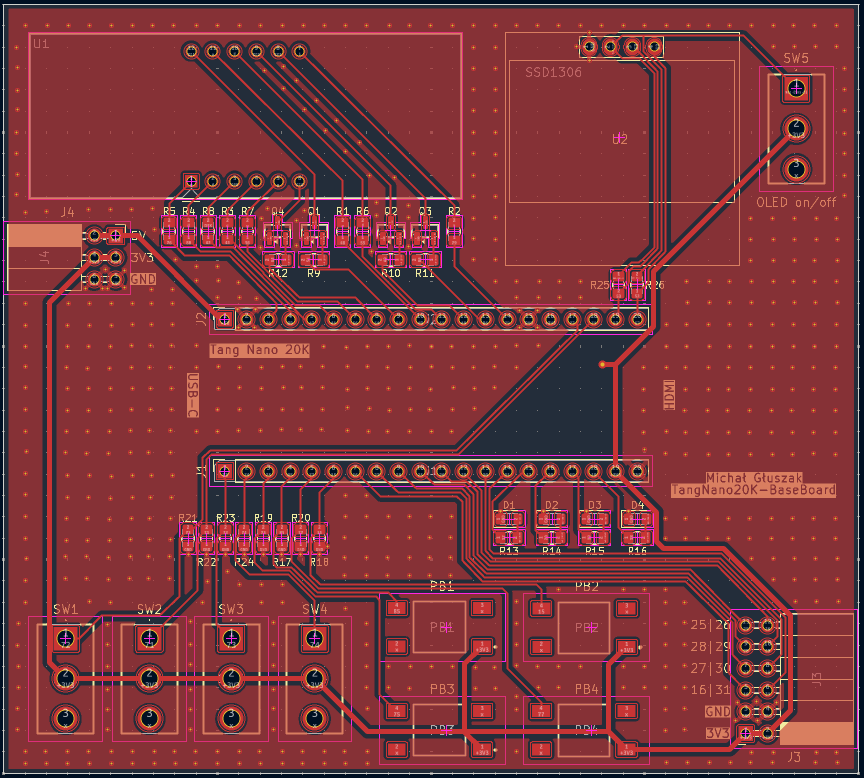
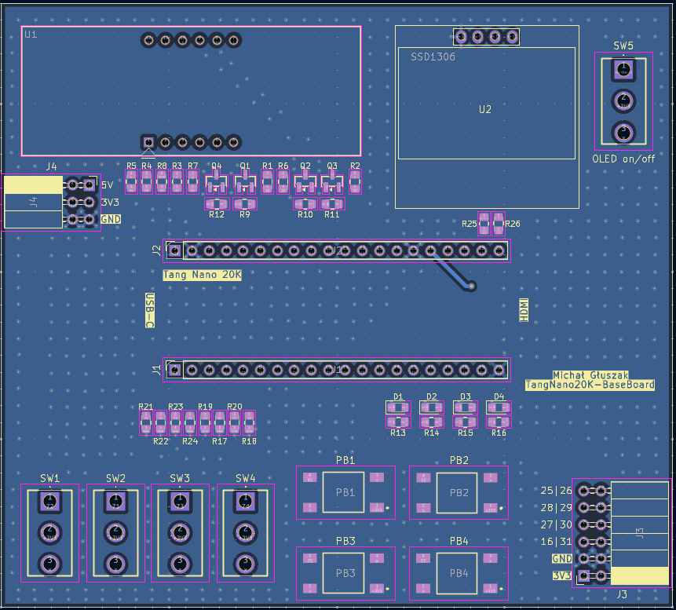

# Tang Nano 20K Expansion Baseboard

## Project Status

**PCB design prototype — Not fabricated or hardware-tested.**

The schematic and PCB layout were designed in KiCad. The board has not been manufactured or physically tested, so its functionality has not been verified on real hardware. The design may require further revisions before fabrication.

## About the Project

The **Tang Nano 20K Expansion Baseboard** is a custom PCB expansion board designed to make learning and prototyping digital circuits easier using Hardware Description Languages (HDL), such as Verilog and VHDL.

The idea for this project came from a desire to test written code in practice. Commercial evaluation platforms, like Basys 3 or boards based on Artix 7 chips, are relatively expensive. As an alternative, I chose the Tang Nano 20K FPGA development board, which offers great features at a very affordable price (around 120 PLN). To make working with this module easier, I designed a dedicated expansion board.

A huge advantage of this solution is its modularity – the Tang Nano 20K module is not soldered permanently. It is placed in pin headers, so you can take it out anytime and use it in another project directly on a breadboard.

## Features

* **Budget-friendly alternative:** A full evaluation environment for learning FPGA at a fraction of the cost of commercial solutions.
* **Modularity (Plug & Play):** The ability to easily remove the Tang Nano chip and use it outside the motherboard.
* **Data visualization:** Built-in **4 LEDs**, a **4-digit 7-segment display** (perfect for testing things like BCD decoders or counters), and support for an **OLED screen**, which makes viewing results and fast code debugging much easier.
* **Input interface:** The board has **4 push-buttons** and **4 slide switches**, which are necessary for manually setting logic states (0/1) and testing state machines.
* **Expandability (PMOD):** An integrated PMOD standard connector allows you to easily connect a wide range of external peripheral modules, such as sensors (e.g., temperature), converters, or additional interfaces.

## PCB Technical Specifications

During the PCB design in KiCad, I focused on organizing signal routing, maintaining ground planes, and applying via stitching to support signal integrity and reduce potential electromagnetic interference (EMI).

* **Board dimensions:** 100 mm x 90 mm.
* **Signal trace width (0.25 mm):** Routed tightly and compactly to minimize their length and delays.
* **Power trace width (0.6 mm):** Wider traces were used for power distribution to reduce resistance and voltage drops.
* **Two-layer PCB:** Most signal and power traces were routed on the top layer, with only one trace routed on the bottom layer to minimize interruptions to the ground plane.
* **Ground Planes:** GND copper pours were added on both PCB layers to provide return paths for signals and improve grounding.
* **Via Stitching:** Multiple stitching vias were used to connect the top and bottom GND copper pours, with the aim of maintaining ground continuity and reducing return-path impedance.

## Schematic

The schematic is divided into logical blocks: Tang Nano 20K Connectors, User LEDs, GPIO Expansion Headers, 4-Digit 7-Segment Display, Push Buttons, Slide Switches, and OLED Display (I2C).

## PCB Design

Below is a screenshot of the PCB layout showing the routing and via stitching structure.

**Top Layer:**

**Bottom Layer:**

## Bill of Materials (BOM)

To make the review and assembly of the board easier, I generated an interactive Bill of Materials (BOM). You can closely inspect the routing and component placement there.

👉 **[Open Interactive BOM](https://michalgluszak.github.io/TangNano20K-BaseBoard/Documentation/bom/ibom.html)**

---
*Project created in KiCad 10.0.*